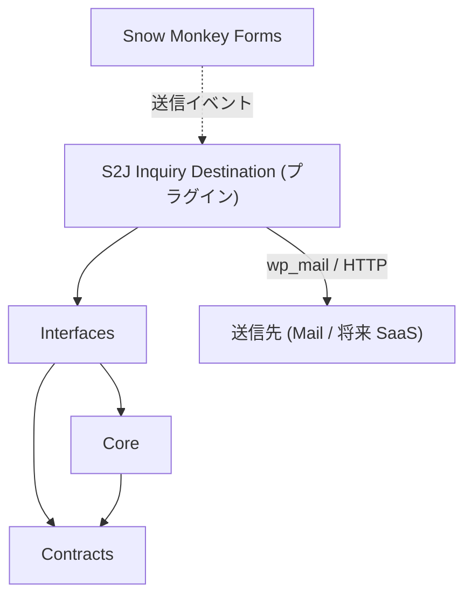

# S2J Inquiry Destination Service - アーキテクチャー

## 設計意図 (ゴール)

問い合わせの正規化・検証・送信材料の組立を、WordPress と `wp_mail` / HTTP 実行から切り離し、PHPUnit だけで回帰できるようにします。

## 設計方針

* FOP + Clean Coding。Clean Architecture の定型分割は、採用しない ([principles.md](./principles.md))。
* Core は、純関数と不変レコードに閉じる。
* v0.3仕様: **Mail + Backlog + Asana** アダプタ (純関数)。HTTP 実行はプラグイン。
* HTTP 実行アダプタ (`adapters/http/`) は、**置かない** (Webinar Service と同型。実行はプラグイン)。

## レイヤー構成

**Mail Transport** (SMTP、DKIM / SPF / DMARC、受信箱到達) は表の外側 (プラグイン Runner + ホスト) です。Service は [core/transport_boundary_spec.md](./core/transport_boundary_spec.md) のとおり **MailMaterial** までとします。

| 層 | 責務 | 非責務 |
| --- | --- | --- |
| Contracts | ペイロード、宛先、Mail 材料、結果レコードの形 | 検証本体 |
| Core | 正規化、検証、dispatch 選択、Mail 文面組立、結果写像 | I/O |
| Interfaces | 公開関数の入口 | ドメイン規則の重複 |



## フォルダー構成 (想定)

**公開面は、名前空間で構成された関数** です。正本は [interfaces/php_api_spec.md](./interfaces/php_api_spec.md)。`Core\` 以下は内部実装であり、プラグインは直接依存しません。

実装時のファイル名は [implementation.md](./implementation.md) と同期します。

```plaintext
s2j-inquiry-destination-service/
├── README.md
├── LICENSE
├── composer.json          # s2j/inquiry-destination-service
├── phpunit.xml
├── phpstan.neon
├── phpcs.xml.dist
├── package.json             # lint:docs 等 (任意)
├── docs/                    # 確定仕様 (正本)
├── docs_mod/                # 改訂起草 ([README](../docs_mod/README.md))
├── coverage/                # PHPUnit 生成物 (gitignore)
├── src/
│   ├── Core/
│   │   ├── Payload.php      # 正規化
│   │   ├── Validate.php     # 不足コード
│   │   ├── Dispatch.php     # kind → アダプタ
│   │   ├── Result.php       # 結果写像
│   │   └── Adapters/
│   │       ├── Mail.php
│   │       ├── SaasBacklog.php
│   │       └── SaasAsana.php
│   └── functions.php        # 公開 API (autoload.files 想定)
└── tests/
    ├── Unit/
    └── Fixtures/            # ペイロード・宛先 JSON
```

## 技術スタック

| 項目 | 方針 |
| --- | --- |
| PHP | [build_and_release.md §PHP 要件](./engineering/build_and_release.md#php-要件-本ドキュメントが正本) に従う |
| テスト | PHPUnit (WordPress なし) |
| 静的解析 | PHPStan level8目標 |
| スタイル | PHPCS (PSR-12基本) |
| ドキュメント lint | `@s2j/docs-linter` / `npm run lint:docs` |
| 配布 | Packagist (`s2j/inquiry-destination-service`) |

## プラグインとの境界

| 置き場 | 中身 |
| --- | --- |
| 本ライブラリ | ペイロード正規化、宛先検証、Mail / SaaS の **材料**、結果レコード |
| S2J Inquiry Destination | Snow Monkey Forms フック、設定、秘密情報、`wp_mail` / HTTP、ログ、UI |
| kis-inquiry | KIS 専用ページ・文言 (送信ロジックは抱え込まない) |

## 関連

* 公開面: [interfaces/php_api_spec.md](./interfaces/php_api_spec.md)
* 送信ポート: [core/dispatch_spec.md](./core/dispatch_spec.md)
