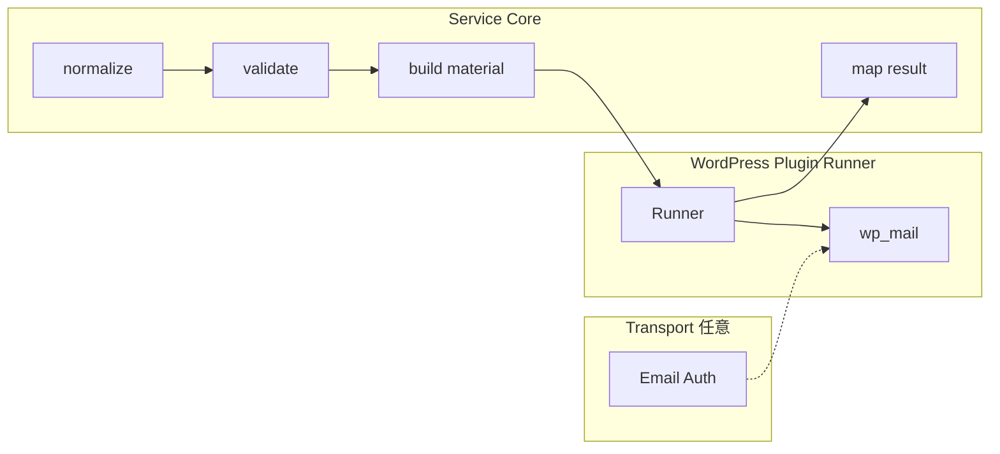

# S2J Inquiry Destination Service - リリース実装仕様 (v0.4草案)

**状態:** 起草 (`docs_mod/`)。確定後 [`../docs/`](../docs/) に反映する ([documentation_governance.md](../docs/governance/documentation_governance.md))。**別名ファイル (`_v04` 等) は作らない。**

**進捗:** [status.md](./status.md) / **改訂メモ:** [modification.md](./modification.md)

**Companion プラグイン:** [S2J Inquiry Destination v0.2](https://github.com/stein2nd/s2j-inquiry-destination/blob/main/docs_mod/release_v0.2_spec.md) (Mail 配信: [mail_deliverability_spec.md (草案)](https://github.com/stein2nd/s2j-inquiry-destination/blob/main/docs_mod/mail_deliverability_spec.md))。

---

## 0. 文書の位置付け (本ファイルと `service_spec`)

本ファイルは **`service_spec.md` の代替・上書き正本ではありません**。semver **0.4.0 イニシアチブ**の orchestration (Why / What / How、触るファイル、リリース手順、完了条件) です。

| 層 | 確定後の正本 | 起草 (`docs_mod/`) |
| --- | --- | --- |
| 規則 (Transport 境界など) | `docs/core/*` 等 | 例: [core/transport_boundary_spec.md](./core/transport_boundary_spec.md) |
| 統合見取り図 | [`docs/service_spec.md`](../docs/service_spec.md) | [service_spec.md](./service_spec.md) (ミラー) |
| 本リリース計画 | archive 等に freeze 可 | **本ファイル** |

規則本文はミラー spec に書き、本ファイルは **どこに何をマージするか** を束ねます。確定後も残る常設仕様は `docs/` の各ファイルです (v0.3 SaaS と同型)。

---

## 1. 目的 (Why)

プラグイン v0.2で **Mail 認証を Transport 層 (`Email Auth` + `wp_mail`) に委譲** する方針に合わせ、Service 側で **「Transport / メール認証は Service 外」** を semver **0.4.0** として **文書と契約で明確化** します。

**公開 PHP API (`normalize_inquiry_payload` 等) の breaking change は、原則、しません。** `MailMaterial` は v0.3 以来 **`to` / `subject` / `body` / `content_type` の4キーのみ** です (v0.4 はその **除外** を明文化)。

## 2. スコープ (What)

### 2.1. 含める

| 項目 | 内容 |
| --- | --- |
| **Transport 境界 SoT** | 新規正本 [core/transport_boundary_spec.md](./core/transport_boundary_spec.md) (確定時 `docs/core/` 同名) |
| **横断追記** | [overview.md](./overview.md)、[principles.md](./principles.md)、[architecture.md](./architecture.md)、[service_spec.md](./service_spec.md) |
| **Mail 材料契約** | [core/mail_adapter_spec.md](./core/mail_adapter_spec.md): 4キーのみ。認証・Transport キーを **追加しない** |
| **プラグイン Runner** | [interfaces/usage_spec.md](./interfaces/usage_spec.md) §Mail Runner: From / Reply-To / `Content-Type` 等 |
| **契約・用語** | [contracts/data_contract_spec.md](./contracts/data_contract_spec.md)、[contracts/data_dictionary.md](./contracts/data_dictionary.md)、[specs.md](./specs.md) 索引 |
| **バージョン** | Packagist **`0.4.0`**。CHANGELOG に Transport 境界の明文化 |
| **テスト** | 既存 PHPUnit **39** 件 (v0.3基準) green。契約スナップショット変更 **なし** ([test-results.md](./test-results.md)) |
| **プラグイン依存** | Inquiry Destination v0.2が `composer.json` で **`^0.4.0`** を要求 |

### 2.2. 含めない (非目標)

| 項目 | 理由 |
| --- | --- |
| `build_dispatch_material` に DKIM / SMTP パラメータ | Transport は WordPress 層 |
| 新 SaaS `kind` (Jira 等) | 別イニシアチブ |
| `inquiry_type` 規則変更 | v0.2で十分 |
| Mail 材料の HTML / multipart | プラグイン非対応のまま |

## 3. 設計 (How)

### 3.1. レイヤ図 (Service 視点)

詳細・責務表は [transport_boundary_spec.md §レイヤ](./core/transport_boundary_spec.md) を正本とします (Service は **normalize → validate → build material → map result** まで)。

### 3.2. ドキュメント (ミラー → `docs/` 確定時)

**1ページ集約:** Transport 規則の SoT は **`core/transport_boundary_spec.md` のみ**。他 doc はリンク + 1〜2行要約。

| ミラー (`docs_mod/`) | 確定 (`docs/`) | 操作 |
| --- | --- | --- |
| [core/transport_boundary_spec.md](./core/transport_boundary_spec.md) | `core/transport_boundary_spec.md` | **新規追加** |
| [overview.md](./overview.md) | `overview.md` | 非目的 / 非責務 |
| [principles.md](./principles.md) | `principles.md` | 方針表 |
| [architecture.md](./architecture.md) | `architecture.md` | Runner 注記 |
| [service_spec.md](./service_spec.md) | `service_spec.md` | §Transport 境界 |
| [core/mail_adapter_spec.md](./core/mail_adapter_spec.md) | `core/mail_adapter_spec.md` | 除外キー § |
| [interfaces/usage_spec.md](./interfaces/usage_spec.md) | `interfaces/usage_spec.md` | §Mail Runner |
| [specs.md](./specs.md) | `specs.md` | 索引 + SoT |
| [contracts/data_dictionary.md](./contracts/data_dictionary.md) | `contracts/data_dictionary.md` | 用語 |
| [contracts/data_contract_spec.md](./contracts/data_contract_spec.md) | `contracts/data_contract_spec.md` | Mail 出力注記 |

### 3.3. 公開 API

* 4関数シグネチャ: **変更なし** (v0.3互換)。
* `MailMaterial` / `HttpRequestMaterial` 判別: **変更なし**。

semver **minor** (`0.4.0`): 文書明確化 + プラグイン v0.2同時リリースの **サポート・マトリックス** 更新。

## 4. リリース手順 (Service 側)

1. ミラー内容を `docs/` に反映 ([modification.md §マージ前チェック](./modification.md))。
2. `CHANGELOG.md` **0.4.0**、`composer.json` version / tag **`v0.4.0`** (コード変更なし想定)。
3. Packagist 公開、`php-quality` CI green。
4. プラグイン側 `composer update s2j/inquiry-destination-service` → **v0.2.0** リリース。

## 5. 完了条件

| # | 条件 |
| --- | --- |
| 1 | Transport 非目標が Service `docs/` に記載され、プラグイン [mail_deliverability_spec.md (草案)](https://github.com/stein2nd/s2j-inquiry-destination/blob/main/docs_mod/mail_deliverability_spec.md) から [transport_boundary_spec.md](./core/transport_boundary_spec.md) (確定後 `docs/core/`) にリンクできる |
| 2 | PHPUnit / PHPStan / PHPCS 既存ゲート green (`39` tests、スナップショット不変) |
| 3 | Inquiry Destination v0.2の `composer.json` が `^0.4.0` で lock 更新済み |
| 4 | 両リポジトリ CHANGELOG に **0.4.0** / **0.2.0** エントリ |

## 6. プラグイン側との同期

* v0.4 の **規則草案 SoT** は [transport_boundary_spec.md](./core/transport_boundary_spec.md) (確定後 `docs/core/`)。本ファイルは **イニシアチブ索引** (プラグイン [release_v0.2_spec.md](https://github.com/stein2nd/s2j-inquiry-destination/blob/main/docs_mod/release_v0.2_spec.md) と対称)。
* プラグイン [docs_mod/service/README.md](https://github.com/stein2nd/s2j-inquiry-destination/blob/main/docs_mod/service/README.md) は、ここへのポインタのみ。
* 確定後、プラグイン [specs.md](https://github.com/stein2nd/s2j-inquiry-destination/blob/main/docs/specs.md) の Service バージョン表記を **`^0.4.0`** に更新する。
