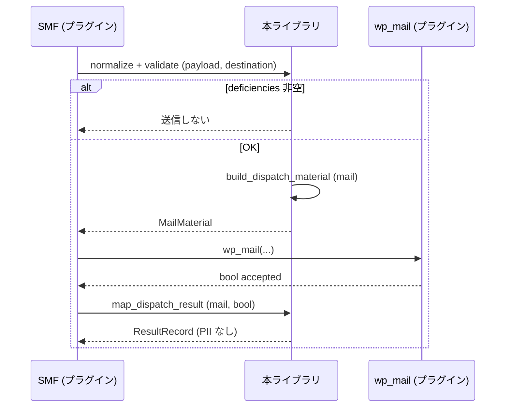

# S2J Inquiry Destination Service - コンセプト

## 背景

MW WP Form は保守停止に向かっており、WordPress DB に問い合わせ案件を無制限に溜めたくない、という要件があります。問い合わせページは Snow Monkey Forms (SMF) で作り、送信先は当面メール (PHPMailer / `wp_mail`)、将来は Backlog / Asana 等の REST API 付き SaaS に移行する想定です。

## 課題

| 課題 | 本ライブラリでの解き方 |
| --- | --- |
| 送信ロジックを kis-inquiry と他サイトで複製する | 統一ペイロード + アダプタを1パッケージに集約 |
| ユニットテストのたびに WordPress が必要 | 純関数 + PHPUnit のみ |
| 個人情報が、ログや結果に残る | 結果レコードの境界を spec で固定 |
| 種別混在 (営業 / 採用) | 種別 (`inquiry_type`) ごとに宛先必須。共通アドレスへの退避は作らない |

## ユースケース (初版)

1. 訪問者が、Snow Monkey Forms で問い合わせを送信する (プラグインが Snow Monkey Forms フックで受ける)。
2. プラグインが、フォーム ID から **種別 slug** (`inquiry_type`。例: `sales` / `recruit` / 管理画面で追加した slug) を引き、統一ペイロードを組む。
3. プラグインが、その種別の **宛先レコード** を渡し、本ライブラリが検証 → Mail 材料を返す。
4. プラグインが、`wp_mail` を1回実行する。
5. プラグインが、戻り値を本ライブラリに渡し、**結果レコード** を得る。成功まで完了画面を出さない (UI はプラグイン)。

## 処理フロー (論理)

本節のシーケンス図は、プラグイン実装・本ライブラリ実装・テスト設計の **正規フロー (canonical)** です。他ドキュメントはここに追随します。



## コンセント変換

```text
[フォーム送信] → [統一ペイロード] → [設定で選んだ送信先]
```

本ライブラリの責務は、**右端の「送信先向け材料」** までとします。左端のフォーム翻訳は、プラグインです。

## 関連

* 決定事項の一覧: [service_spec.md §決定](./service_spec.md#決定)
* アーキテクチャー: [architecture.md](./architecture.md)
