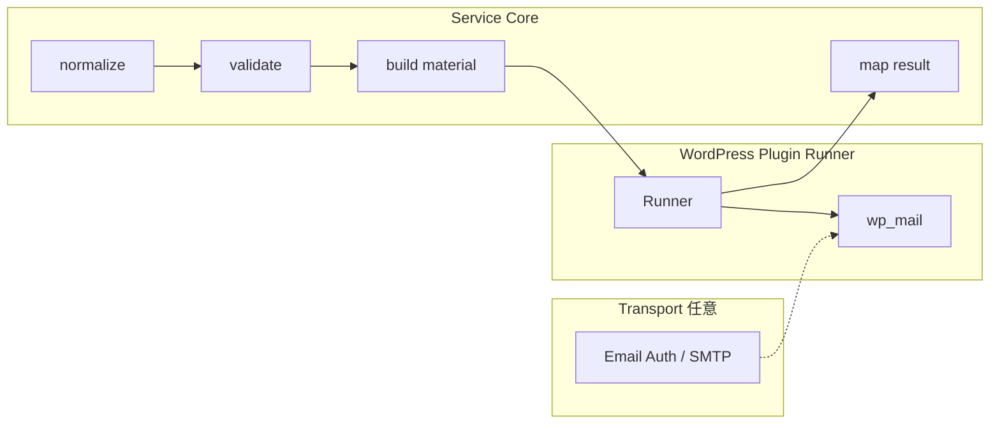

# S2J Inquiry Destination Service - Transport 境界 (Mail)

**Companion:** [S2J Inquiry Destination v0.2](https://github.com/stein2nd/s2j-inquiry-destination/blob/main/docs_mod/release_v0.2_spec.md) (Mail 配信、Email Auth はプラグイン正本: [mail_deliverability_spec.md (草案)](https://github.com/stein2nd/s2j-inquiry-destination/blob/main/docs_mod/mail_deliverability_spec.md))。

## 目的

Mail 送信について、**Service Core が保証する契約** (正規化 → 検証 → **MailMaterial** → 結果写像) と、**Transport 層** (SMTP、`wp_mail` / PHPMailer、DKIM / SPF / DMARC、到達性) の責務分界を、semver **0.4.0** で文書上固定します。

**公開 PHP API (4関数) のシグネチャと、`MailMaterial` / `HttpRequestMaterial` の判別は、v0.3系リリースと互換のまま変更しません。**

## 用語

SaaS (`kind`: `saas_backlog` / `saas_asana`) の **HTTP 認証ヘッダー** (API キー、PAT) は **HttpRequestMaterial** の一部であり、本書の「Mail Transport」とは別系統です ([saas_backlog_adapter_spec.md](./saas_backlog_adapter_spec.md))。

| 用語 | 意味 |
| --- | --- |
| **Service Core** | 本 Composer ライブラリ。WordPress / HTTP / SMTP を呼ばない純関数群 |
| **MailMaterial** | Core が返す Mail 用材料。キーは [mail_adapter_spec.md](./mail_adapter_spec.md) の4つのみ |
| **プラグイン Runner** | [S2J Inquiry Destination](https://github.com/stein2nd/s2j-inquiry-destination) が `build_dispatch_material` の直後に担う実行層。`wp_mail` / HTTP を呼ぶ |
| **Transport 層** | ホスト SMTP 設定、PHPMailer 経路、**Email Auth** (DKIM / SPF / DMARC 等)、受信箱到達。Service **非目標** |
| **Email Auth** | 送信ドメイン認証・署名。プラグインまたはホスト / MTA が設定。Service は材料に含めない |

## レイヤ (Service 視点)

Service の契約は **normalize → validate → build material → map result** までとします。Runner 以降はプラグイン + ホストが担います。

正規シーケンスは [concept.md §処理フロー](../concept.md#処理フロー-論理) に追随します。本図は **Mail 経路の責務箱** の補足です。

## 責務表

| 項目 | Service Core | プラグイン Runner | Transport / ホスト |
| --- | --- | --- | --- |
| 件名 / 本文 / To (`MailMaterial`) | 組立 | `wp_mail` 引数に渡す | — |
| `Content-Type` + `charset=UTF-8` | `content_type` のみ材料化 | ヘッダー文字列を組む | — |
| From / Reply-To / Cc / Bcc | **含めない** | 方針に従い付与 | — |
| 添付 (multipart) | **含めない** (plain 初版) | 必要なら付与 (非目標のまま) | — |
| DKIM / SPF / DMARC | **含めない・非目標** | 設定 UI / フックはプラグイン側仕様 | MTA / プラグイン |
| SMTP ホスト / ポート / 認証 | **非目標** | `wp_mail` / PHPMailer 設定は WP 定数・プラグイン | レンタルサーバー |
| 受信箱到達の確認 | **不可** (成功 = `wp_mail` bool) | ステージングで人手確認可 | 配信ログ |
| `map_dispatch_result('mail', bool)` | 写像 | bool を渡す | — |

## MailMaterial 契約 (Transport 除外)

正本フィールド定義は [mail_adapter_spec.md](./mail_adapter_spec.md)。v0.4.0で追加するのは **除外の明示** です。

### 許可キー (固定)

| キー | 備考 |
| --- | --- |
| `to` | リスト。`destination.mail_to` 由来 |
| `subject` | 件名規則は mail_adapter |
| `body` | プレーンテキスト |
| `content_type` | 初版 `text/plain`。`charset` は材料に含めない |

### 追加しないキー (minor でも v0.4スコープ外)

将来ヘッダーを材料に載せる場合は **別イニシアチブ** とし、SemVer と [data_contract_spec.md](../contracts/data_contract_spec.md) を同時更新します。v0.4.0では **追加しません**。

`build_dispatch_material` が Mail 向けに返しては **ならない** 例 (列挙は網羅的 SoT ではなく、実装でキーを足してよいか判断するための例示):

* `from`, `reply_to`, `reply-to`, `sender`
* `headers` (任意ヘッダー配列)
* `attachments`, `embedded_images`
* `smtp_*`, `dkim_*`, `signing_*`
* DKIM / SPF / DMARC に相当する設定フィールド

## 公開 API

| 関数 | v0.4.0 |
| --- | --- |
| `normalize_inquiry_payload` | 変更なし |
| `validate_inquiry_dispatch` | 変更なし |
| `build_dispatch_material` | 変更なし (Mail は上記4キーのみ) |
| `map_dispatch_result` | 変更なし |

## テスト期待 (Service repo)

* PHPUnit **39** 件 (v0.3.0基準) を green 維持。
* [tests/Fixtures/contracts/mail_sales_body.txt](../../tests/Fixtures/contracts/mail_sales_body.txt) の契約スナップショットは **変更しない** (`MailMaterial` は4キーのまま)。

## バージョン・依存

| パッケージ | 版 |
| --- | --- |
| 本ライブラリ | **0.4.0** (文書明確化。API breaking なし) |
| S2J Inquiry Destination (Companion) | **0.2.0** — `composer.json` で `s2j/inquiry-destination-service`: **`^0.4.0`** |

## 関連

* Mail 材料: [mail_adapter_spec.md](./mail_adapter_spec.md)
* 呼び出し例: [../interfaces/usage_spec.md](../interfaces/usage_spec.md)
* 概要・非目標: [../overview.md](../overview.md)
* 設計原則: [../principles.md](../principles.md)
* 統合見取り図: [../service_spec.md](../service_spec.md)
* 索引: [../specs.md](../specs.md)
* イニシアチブ証跡: [../archive/mod-v0.4-transport/](../archive/mod-v0.4-transport/)
