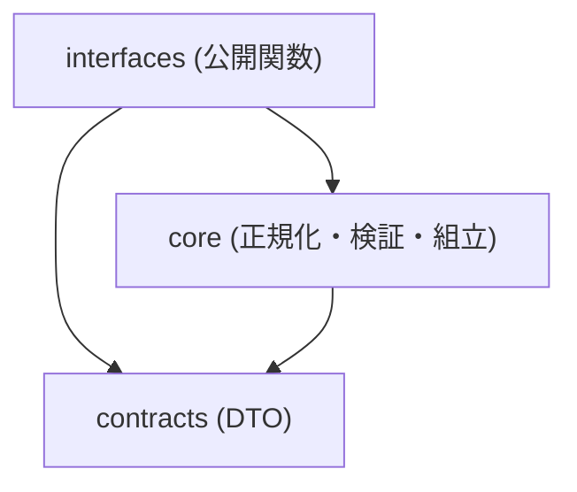

# S2J Inquiry Destination Service - 仕様書の起点

本プロジェクトの **実装仕様** は、下記のドキュメントに分散して定義します。
各ドキュメントへの導線のみを提供し、詳細な規則は個別ファイルに委譲します。

本 `docs/` が **確定仕様** の正本です。統合見取り図は [service_spec.md](./service_spec.md)。改訂案の起草は [docs_mod/](../docs_mod/README.md) で行い、合意後に本ディレクトリに反映します。構成は [S2J Webinar Survey Service の docs/](https://github.com/stein2nd/s2j-webinar-survey-service/tree/main/docs) および [S2J Webinar Service の docs/](https://github.com/stein2nd/s2j-webinar-service/tree/main/docs) に倣い、本ライブラリに必要な層だけを置きます。

## 読み方ガイド

本ドキュメント群は、「Why → What → How → Usage → Operations」の順で理解することを前提とします。

### 推奨読み順 (初読)

1. **[concept.md](./concept.md)** — なぜ存在するか (処理フローの **正規フロー** 図を含む)
2. **[contracts/data_contract_spec.md](./contracts/data_contract_spec.md)** — 入出力契約
3. **[architecture.md](./architecture.md)** — レイヤと依存
4. **[core/](./core/payload_spec.md)** — ペイロード、宛先、検証、アダプタ、結果
5. **[interfaces/usage_spec.md](./interfaces/usage_spec.md)** — 呼び出し方
6. **[engineering/ci.md](./engineering/ci.md)** — CI と配布

### 役割別読み順

#### 呼び出し側 (S2J Inquiry Destination プラグイン)

1. [interfaces/usage_spec.md](./interfaces/usage_spec.md)
2. [interfaces/php_api_spec.md](./interfaces/php_api_spec.md)
3. [contracts/data_contract_spec.md](./contracts/data_contract_spec.md)

#### 実装者 (本ライブラリ)

1. [architecture.md](./architecture.md)
2. [contracts/](./contracts/data_contract_spec.md)
3. [core/](./core/payload_spec.md)
4. [testing_spec.md](./testing_spec.md)
5. [governance/documentation_governance.md](./governance/documentation_governance.md)

## ドキュメント一覧

### Why (基本情報)

| ドキュメント | 内容 |
| --- | --- |
| [概要](./overview.md) | プロジェクト概要、責務、非対応 |
| [コンセプト](./concept.md) | 背景、課題、ユースケース、処理フロー |
| [アーキテクチャー](./architecture.md) | レイヤ、フォルダー、依存方向 |
| [設計原則](./principles.md) | Source of Truth、純関数、境界 |
| [統合見取り図](./service_spec.md) | サービス全体の要約。フィールド規則の正本は `core/` |

### Domain (コア)

| ドキュメント | 内容 |
| --- | --- |
| [統一ペイロード](./core/payload_spec.md) | 問い合わせ本文の形と正規化 |
| [宛先](./core/destination_spec.md) | 種別 (`inquiry_type`) ごとの送信先レコード (1回の送信で1件) |
| [検証](./core/validation_spec.md) | 不足コードと送信可否 |
| [送信ポート](./core/dispatch_spec.md) | 種類 (`mail` 等) からアダプタ関数を選ぶ |
| [Mail アダプタ](./core/mail_adapter_spec.md) | 管理者宛メール文面の組立 (初版) |
| [結果レコード](./core/result_spec.md) | 成功・失敗と個人情報の境界 |

### What (契約)

| ドキュメント | 内容 |
| --- | --- |
| [入出力仕様](./contracts/data_contract_spec.md) | DTO、結果レコード |
| [データ辞書](./contracts/data_dictionary.md) | 用語、型、制約 |

### How (インターフェイス)

| ドキュメント | 内容 |
| --- | --- |
| [PHP 公開面](./interfaces/php_api_spec.md) | Composer から見える関数 |
| [使用方法](./interfaces/usage_spec.md) | プラグインからの呼び出し例 |

### エンジニアリング

| ドキュメント | 内容 |
| --- | --- |
| [CI](./engineering/ci.md) | 品質ゲート |
| [ビルドおよびリリース](./engineering/build_and_release.md) | Packagist、セマンティックバージョン |

### ガバナンス

| ドキュメント | 内容 |
| --- | --- |
| [ドキュメンテーション](./governance/documentation_governance.md) | README と docs の整合 |

### その他

| ドキュメント | 内容 |
| --- | --- |
| [テスト戦略](./testing_spec.md) | テストレベル、必須分岐 |
| [実装モジュール対応](./implementation.md) | 仕様 § と `src/` の対応 (実装時) |
| [実装状況](./status.md) | 機能単位の進捗 |

## 本ライブラリに置かない層

[S2J Similarity Service の docs/](https://github.com/stein2nd/s2j-similarity-service/tree/main/docs) にあるが、初版では持たないものです。

| Similarity / Webinar 側 | 本ライブラリ |
| --- | --- |
| OpenAPI / codegen / TS SDK | なし。契約は PHP の DTO と本 docs |
| REST サーバー / WordPress HTTP Adapter | なし。HTTP 実行はプラグイン |
| Snow Monkey Forms フック | なし。プラグイン |
| 設定画面、API キー保存 | なし。実行時に渡される認証材料のみ受け取る (保存しない) |
| 再送キュー、WP Cron | なし |
| SRE (観測・スケール) | なし。インプロセスの純関数 |

## 依存関係ルール

### 禁止事項

* Core が WordPress、`wp_mail`、HTTP クライアント、Snow Monkey Forms を知らない。
* Contracts にビジネス規則 (不足判定の本体) を置かない。
* Interfaces にドメイン規則を埋め込まない (薄い入口にする)。
* 使わない送信先種類の空アダプタを置かない (初版は `mail` のみ)。

## Source of Truth (SoT)

| 対象 | 正本 |
| --- | --- |
| ペイロード・宛先・検証・文面組立の規則 | [core/](./core/payload_spec.md) |
| 入出力の型とフィールド | [contracts/data_contract_spec.md](./contracts/data_contract_spec.md) |
| 用語の意味 | [contracts/data_dictionary.md](./contracts/data_dictionary.md) |
| 公開 PHP API | [interfaces/php_api_spec.md](./interfaces/php_api_spec.md) |
| ユーザー向け最短手順 | ルート [README.md](../README.md) と [usage_spec.md](./interfaces/usage_spec.md) |

契約と README が食い違う場合は、core / contracts を正とし、README を追随させます。

## 関連リポジトリ

| 名称 | 役割 |
| --- | --- |
| [S2J Inquiry Destination](https://github.com/stein2nd/s2j-inquiry-destination) | WP プラグイン (SMF、設定、`wp_mail` / HTTP) |
| 本ライブラリ | 統一ペイロード、送信先ポート、Mail / 将来 SaaS の材料組立 |

プラグイン仕様のドラフト: [s2j-inquiry-destination docs_mod/specs.md](https://github.com/stein2nd/s2j-inquiry-destination/blob/main/docs_mod/specs.md)
